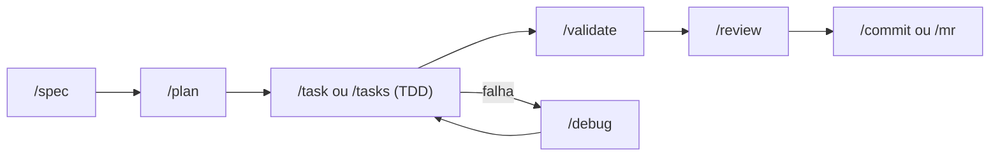

# Arquitetura

Decisões de desenho da config. Inventário e uso estão no [README](../README.md); papéis dos agentes no [registro](AGENTS_REGISTRY.md).

## 1. Modelos e provider

Todo modelo de nuvem passa pelo provider `claude-code` (plugin `@openchamber/opencode-claude`), que chama o CLI `claude` com a assinatura. O provider `local-gpu` (Ollama, `qwen2.5-coder:7b`, timeout 60 s, chunkTimeout 30 s) serve só o agente `title`. O `opencode-antigravity-auth` fica como reserva para quando a cota do Claude acabar.

| Camada | Modelo |
| :--- | :--- |
| Padrão global | Sonnet 5.5 |
| `orchestrator`, `architect`, `debugger`, `build`, `plan` | Opus 5.5 1M |
| Demais agentes e `explore`/`general` | Sonnet 5.5 |
| `title` | `local-gpu/qwen2.5-coder:7b` |

O runner do V2.2.6 ignora o `model` de agentes primários; o plugin `agent-model-sync` corrige aplicando o modelo do agente à sessão (refs: anomalyco/opencode#49765).

## 2. Orchestrator e agentic

- `orchestrator` (padrão): detém o contexto, decide e especifica; delega a subagentes (`subagent`) e confere diff e testes antes de responder. Não edita (`edit: deny`) e o plugin `session-hygiene` bloqueia escrita via shell, então quem escreve são os subagentes.
- `agentic`: executa direto, em passo único, ajustes pequenos.
- Divisão por independência: cada subagente é dono exclusivo de um conjunto de arquivos; frentes independentes rodam em paralelo (até 4, limite de RAM); o mesmo `sessionID` continua a mesma frente.
- Detalhes do fluxo: [`agents/orchestrator.md`](../agents/orchestrator.md).

## 3. Guardrails

| Mecanismo | O que faz |
| :--- | :--- |
| `session-hygiene` | Bloqueia escrita de arquivo via shell (`sed -i`, `perl -i`, redirecionamento, heredoc, `tee`, Python lendo script do stdin). Exceções: `/tmp`, `/dev/null`, `*.log`. Falha interna do plugin deixa a chamada passar e registra. |
| `policies` | Nega `git push --force`/`-f` e `rm -rf` em `/`, `~`, `$HOME`. |
| `tool_output` | 300 linhas / 16 KB por chamada (`max_lines: 300`, `max_bytes: 16384`): evita despejar logs no contexto. |
| Limites de código | Arquivos ≤ 300 linhas, funções ≤ 40, sem stubs. Verificados pelo [AQEI](METRICS_AQEI.md) e por `ast-linter-hook.py`. |

## 4. Contexto e compaction

| Item | Valor |
| :--- | :--- |
| `claude-context-cap` | Limita modelos 1M a 200k. |
| Compaction | `auto`, gatilho ~185k (200k − buffer 15k), `keep` 30000. |
| Resumo | Haiku 4.5, escolha do bridge. |
| Autocompact do CLI | Só em ~967k: não duplica a compaction do OpenCode. |

Sessões longas: `/checkpoint` gera snapshot e monitora o teto de 40 turnos; `.aiflow/context.md` guarda padrões e armadilhas que sobrevivem à compactação. A poda de sessões antigas e o VACUUM do banco ficam com o `opencode-maintenance.timer` ([catálogo](TOOLING_CATALOG.md#13-opencode-maintenancesh-e-opencode-maintenancetimer)).

## 5. Fluxo `.aiflow`

`.aiflow/task-test.sh` é o contrato de teste de cada tarefa; `/debug` lê `.aiflow/task-test.log`. `.aiflow/` fica fora do git.

## 6. Skills

23 skills locais em `skills/`. As 13 skills do Claude desktop que o OpenCode descobre em `~/.claude/skills/synced` recebem `deny` na permissão `skill` (esse diretório pertence ao Claude Code e não é alterado).
